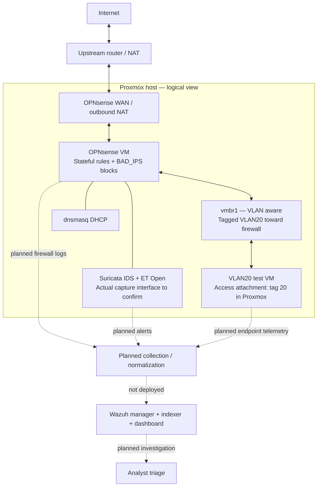

# OPNsense × Proxmox Security Lab

**Network segmentation, stateful filtering and detection engineering in a virtualized homelab.**

An infrastructure-to-investigation portfolio by [John Klunk](https://github.com/JohnKlunk): how traffic crosses a virtual network, where controls apply, why a blocked connection can survive a rule change, and how network events could support a future SOC workflow.

> **Project status:** Firewall, NAT, VLAN20, Suricata IDS and threat-intelligence filtering are reported as implemented in the project history. This repository documents that work; it does not independently certify the current server configuration. **Wazuh is designed only — not installed, connected or validated live.** Server access was unavailable during the monitoring design phase.

## What this project demonstrates

- **Network engineering:** Proxmox `vmbr1` with VLAN awareness; VLAN20 segmentation; access-port versus trunk behavior; DHCP through dnsmasq instead of Kea.
- **Firewall reasoning:** interface direction, rule order, state tracking, outbound NAT and the operational consequences of double NAT.
- **Detection:** Suricata in IDS mode with ET Open; separate `BAD_IPS` alias-based firewall blocking.
- **Investigation design:** three Wazuh use cases connecting network alerts, repeated denies and threat-intelligence hits to analyst triage.
- **Engineering discipline:** explicit assumptions, reproducible validation procedures and a clear boundary between implementation and evidence.

## Architecture at a glance



Solid connections describe the logical lab; dashed connections are **future monitoring**. The tagged firewall attachment is the documented reconstruction pattern, not a recovered VM configuration. Physical NICs, upstream bridge name, exact addressing and capture placement remain unverified. See [architecture and trust boundaries](docs/architecture.md).

## Implementation and evidence

| Area | Project-history status | Evidence in this repository |
| --- | --- | --- |
| Stateful rules and NAT / double NAT | Reported implemented | Design and repeatable checks; no raw captures |
| VLAN20, VLAN-aware `vmbr1`, access/trunk debugging | Reported implemented | Reconstructed setup and troubleshooting |
| dnsmasq DHCP, replacing the Kea approach | Reported implemented | Service choice and validation procedure |
| Suricata IDS with ET Open | Reported implemented | Setup guidance; no reproduced alert result |
| `BAD_IPS` alias and block rules | Reported implemented | Policy design; feed and live rules unverified |
| Wazuh / SOC monitoring | **Concept only** | Architecture and three detection specifications |

No screenshots, alerts, benchmark numbers or successful test results have been invented. All proposed lab tests start as **Not run**. The [provenance record](docs/project-status.md) explains what could and could not be recovered.

## Read the project

| Document | Purpose |
| --- | --- |
| [Architecture](docs/architecture.md) | Traffic flow, VLAN tagging and trust boundaries |
| [Implementation](docs/implementation.md) | Ordered reconstruction guide with checkpoints |
| [Troubleshooting & lessons learned](docs/troubleshooting.md) | State, DHCP, VLAN and NAT reasoning |
| [Security decisions](docs/security-decisions.md) | Choices, tradeoffs and remaining risks |
| [Testing & validation](docs/testing-validation.md) | Positive/negative tests and acceptance criteria |
| [Wazuh monitoring design](docs/wazuh-design.md) | Collection plan, detection logic and analyst workflow |
| [Roadmap](docs/roadmap.md) | Evidence collection and future deployment milestones |
| [Evidence index](evidence/README.md) | How observations will be recorded |
| [References](docs/references.md) | Official technical documentation |

## Repository layout

```text
architecture/                 Editable Mermaid diagram
examples/                     Illustrative policy and inventory; not live exports
docs/                         Implementation, decisions, validation and roadmap
evidence/                     Evidence policy and blank test-record template
README.md                     Portfolio entry point
.gitignore                    Excludes secrets, raw captures and system exports
```

## Scope and limits

This is a learning homelab, not a production SOC or a penetration-test report. IDS alerts and reputation matches require investigation; neither proves compromise. VLAN20 policies apply to routed traffic through OPNsense, not automatically to traffic between peers in the same VLAN. Encrypted payload visibility, IPv6 policy, feed freshness and management isolation require explicit validation.

To reproduce the design, start with the [implementation guide](docs/implementation.md), fill in the [inventory](examples/lab-inventory.md), and capture results using the [test template](evidence/test-record-template.md). No deployable firewall backup or automatic provisioning is included.

## License

A license has not yet been applied. [Licensing recommendation](docs/licensing.md): consider MIT for original examples/code and CC BY 4.0 for original documentation and diagrams. Third-party software, rules and feeds retain their own terms. Public visibility alone does not grant reuse rights.
