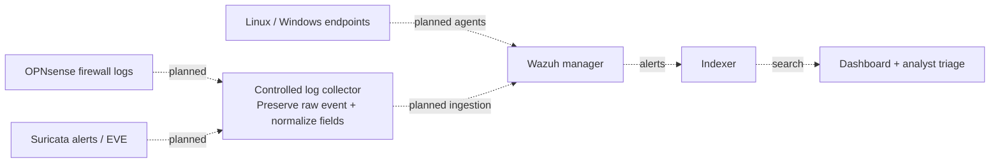

# Wazuh / SOC monitoring design

> **Concept only. Wazuh has not been live deployed.** No manager/indexer/dashboard, connected agents, production log ingestion or confirmed Wazuh alerts are claimed.

## Purpose and proposed collection

Wazuh is a monitoring platform within a SOC workflow. People and procedures still decide whether an alert is actionable.

Proposed approach: send firewall events and Suricata output to a restricted collector, preserve the original message, then implement and test parsing for the actual format. OPNsense can export Suricata EVE to syslog; this does not guarantee that the resulting syslog envelope is accepted as raw EVE JSON by an existing decoder. Validate transport, escaping, timestamps and fields end to end. Endpoint agents are a later addition; no native Wazuh agent on OPNsense is assumed.

Restrict allowed log senders, document transport security, synchronize clocks and separate event time from receipt time. Define storage, rotation, retention and access before enabling bulk collection. Sizes and retention periods remain undecided pending hardware and event-volume measurements.

## Normalized fields

Retain `event_time`, `ingest_time`, `source_system`, `event_type`, `src_ip`, `src_port`, `dst_ip`, `dst_port`, `protocol`, `action`, `interface`, `rule_id`, and raw message. Suricata additionally needs signature ID, signature text, category and native severity. Threat-intelligence context needs the matched firewall rule and its documented association with `BAD_IPS`; generic firewall logs may not contain the alias name.

Do not equate Suricata priority with a Wazuh rule level. Create an explicit mapping after inspecting actual events. Account for NAT and duplicate observations across interfaces.

## Detection specifications — proposed, unimplemented

| ID | Logic | Required context | Initial triage priority |
| --- | --- | --- | --- |
| DET-01 | Suricata alert whose native priority maps to the selected high-priority class | SID, signature, category, timestamp and flow tuple | High; tune after validation |
| DET-02 | At least 10 firewall denies from one source within 60 seconds | Source IP, timestamps, destination/port set, action and interface | Medium; increase only with supporting evidence |
| DET-03 | Internal source denied by the rule mapped to outbound BAD_IPS destination blocking | Internal asset identity, destination, rule ID and alias/feed context | High-interest investigation; not proof of malware |

The DET-02 threshold is an illustrative starting proposal added for this repository. Ten denies alone can indicate a misconfigured application. Distinct destination ports/hosts and recurrence help distinguish potential reconnaissance. Whether this is expressed in native Wazuh rules or collector enrichment remains to be tested.

## Acceptance cases

| Detection | Positive case | Negative / boundary cases |
| --- | --- | --- |
| DET-01 | Benign controlled input containing the intended high-priority signature event | Lower mapped priority; ordinary non-alert EVE event; malformed event handled without false success |
| DET-02 | 10 denies for one source within 60 seconds | 9 denies; 10 split across different sources; 10 outside the window; permitted traffic |
| DET-03 | Owned lab source hits the test target through the mapped BAD_IPS rule | Unrelated deny rule; permitted flow; inbound source match must not be labeled internal outbound contact |

Synthetic fixtures, if added, must be labeled synthetic. Rule XML is intentionally not presented as deployable until field names and decoder behavior are proven.

## Analyst workflow

1. Confirm source, time, rule/signature and original event; check for duplicates or parsing errors.
2. Identify the affected host and whether NAT obscures it.
3. Compare nearby firewall, IDS and available endpoint events.
4. Classify benign activity, misconfiguration, suspicious activity or confirmed incident based on evidence.
5. Document supporting facts, uncertainty and next action. Any containment action requires its own scoped operational decision; automated response is not part of this design.

## Deployment gate

Restore server access → inventory capacity → deploy supported Wazuh components → secure collection → validate one source → test decoders → implement detections → exercise positive/negative cases → collect actual dashboard evidence. Mark the roadmap complete only after these checks.
